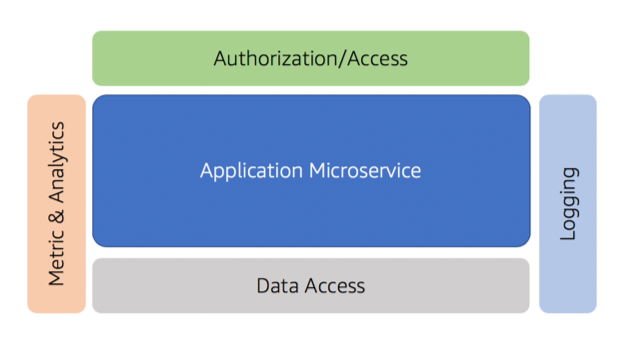
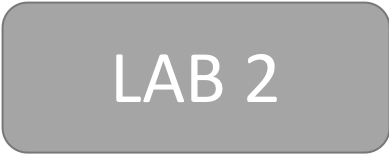
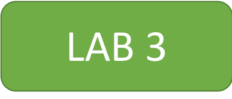

# Building Serverless SaaS with AWS Lambda layers

## Security notice — read before deploying

**This workshop's entire tenant-authentication mechanism is a teaching exercise, not a security
control. Deploy it to a throwaway account, put no real data in it, and delete the stack when you
finish. Do not lift these patterns into an application.**

The labs build tenant awareness up in stages, and securing the boundary is not one of those
stages. Specifically, with file references so you can verify each point:

- **The JWT signing key is a fixed value published in this repository**, and the same value is used
  by both the client simulator and the server. It appears in `Lab2/README.md:13` — where you are
  asked to type it in as part of Lab 2 — and in `token-manager.js` in `Lab3`, `Lab4`,
  `Solution/Lab2`, `Solution/Lab3` and `Solution/Lab4`. Anyone who can read this repository can
  mint a token for any tenant against any deployment that keeps the published key.
- **`token-manager.js` is the only thing standing between a caller and another tenant's data.** It
  calls `nJwt.verify(jwtToken, signingKey)` and then reads `tenantId` straight from the token body.
  Because the key is public, so is the ability to choose that `tenantId`.
- **No API Gateway method has an authorizer.** There is no `AuthorizationType` or `Auth` block in
  any `saas-sam-stack.yaml` in this repository, and no Cognito or Lambda authorizer anywhere. Lab 1
  is deliberately unauthenticated as its starting point, and nothing added later closes the gateway.
- **The tenant identifier is concatenated into the DynamoDB table name** that *is* the isolation
  boundary in the Silo model — `partition-manager.js` lines 112 and 164, in both `Lab4` and
  `Solution/Lab4`, build `tableName + "-Silo-" + tenantId`. Combined with the point above, the
  caller chooses the partition.
- **All eight `server_deploy.sh` scripts deploy to the same stack name**, `saas-sam-stack`. Running
  a different lab's deploy replaces whatever was deployed before it, rather than standing up
  alongside it.

If you adapt this material, what belongs in its place is: a real authorizer in front of the API,
tokens issued and signed by an identity provider you control (Amazon Cognito, for example) rather
than by a key committed to source, verification of the signature *and* the issuer and audience
against that provider, tenant context taken only from a verified claim, and IAM policies scoped per
tenant rather than relying on the application to pick the right table.

**A fresh deployment of this workshop will not succeed as it stands.** Every one of the 48
`Runtime:` declarations across these templates is `nodejs14.x` (and `nodejs14.x` appears 53 times
in total, the remainder under `CompatibleRuntimes` on the layers), and AWS Lambda no longer permits
new function creation on that runtime. You would need to raise the runtime before anything deploys. That bounds who is
exposed to existing long-running deployments and forks rather than new adopters, and it is also why
the published signing key has not been replaced here: changing it would alter what Lab 2 teaches
without protecting anybody who is not already affected.

**If you have an existing deployment of this workshop**, treat every token ever issued against it
as forgeable, and treat the data in it as having been readable and writable by anyone who could
reach the endpoint. Updating this repository does not change a deployment that is already running.

## Introduction
One of the key goals of every software-as-a-service (SaaS) architect, is to create an environment where the complexity of multi-tenancy is largely hidden away from developers. The goal of this session is to introduce frameworks, libraries, and tooling that limits a developer’s need to have any awareness of tenant context. This will free up developers to focus on the features and functionality of their system. 

The general strategy applied here is to move all the code that accesses and applies tenant context into a set of libraries. These libraries are then referenced by each of the components/services in your environment. This is precisely where AWS Lambda Layers comes into picture. In this Lab, we’ll look at how AWS Lambda Layers allows you to centralize your tenant aware libraries without impact the size or load-time of your SaaS application’s functions.

### Hiding Away the Details of Multi-Tenancy
Before we dig into the AWS Lambda Layers, we first need to understand what it means to hide away the details of multi-tenancy. Let’s start by looking at a common microservice that might be part of our SaaS environment. The figure below provides a high-level view of some of the common components that might be part of my service implementation.

<p align="center"></p>

Here you’ll notice that we have our microservice at the center of this diagram. Within this service resides all the business logic and functionality that is within the scope of the microservice. Surrounding it are examples of common constructs that would often be shared by any microservice that would be part of our system. Logging, for example, has been included here to represent the common library that will be used to capture and publish our log messages. The metrics and analytics library, as its name suggests, is used to record any metric data that is associated with the service. At the top of the service, you’ll also see authorization/access. This library is used to acquire tenant context from an incoming request and validate/scope the caller’s access to the service’s functionality. Finally, you’ll notice that we have a Data Access library here as well. This is a common construct for many systems that want to create a standardized model for interacting with the underlying storage and/or database that is used by this service.

So far, there’s nothing particularly distinguishing about this model. However, if you take these same services and place them in a multi-tenant environment, you will find that each one of these services must now incorporate support for tenant context.

In this session, we’ll build a solution that leverages layers to implement logging and metrics in a multi-tenant serverless environment. We’ll demonstrate the use of these layers and how reusable constructs can streamline the experience for SaaS developers.

## Setup Cloud9

If you are running this lab as part an AWS event, then the Cloud9 should already be setup in the AWS accounts provided to you by your instructor. Please skip this section if this is the case. 

    NOTE: This lab is meant to be run in us-east-1. Please make sure that you have selected "N. Virginia" as your region inside AWS Console.

If you are running this lab on your own, then follow these instructions to setup Cloud9 in your AWS account.

<b>Step 1</b>: Navigate to https://raw.githubusercontent.com/aws-samples/aws-serverless-saas-layers/master/Cloud9Setup/saas-cfn-cloud9-stack.yaml. This will display the contents of saas-cfn-cloud9-stack.yaml in your browser. 

<b>Step 2</b>: Copy the contents of this file and save in your local machine as a file by the name of saas-cfn-cloud9-stack.yaml.

<b>Step 3</b>: You can now use this yaml file to create a new stack in your AWS Account. Name the stack as “saas-cfn-cloud9-stack”. Alternatively, you can use below command, if you have AWS CLI installed on your machine. This will automatically deploy the stack and eventually setup Cloud9 for you.

```
aws cloudformation deploy --template-file saas-cfn-cloud9-stack.yaml --stack-name saas-cfn-cloud9-stack
```
<br></br>
## Lab1 – Starting with a single-tenant serverless solution

[](https://github.com/aws-samples/aws-serverless-saas-layers/blob/master/Lab1/README.md "Lab 1")
<br></br>
## Lab2 – Code re-usability and multi-tenancy using AWS Lambda Layers 

[](https://github.com/aws-samples/aws-serverless-saas-layers/blob/master/Lab2/README.md "Lab 2")
<br></br>
## Lab3 – Collect metrices using a metrics manager

[](https://github.com/aws-samples/aws-serverless-saas-layers/blob/master/Lab3/README.md "Lab 3")
<br></br>
## Lab4 – Data partitioning using Silo and Pool model

[](https://github.com/aws-samples/aws-serverless-saas-layers/blob/master/Lab4/README.md "Lab 4")


[Proceed to Lab 1 when ready to begin.](Lab1/)

# License

This library is licensed under the MIT-0 License. See the LICENSE file.
